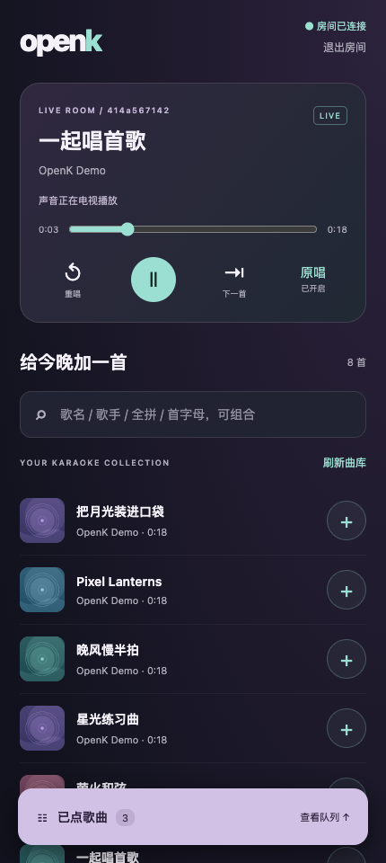
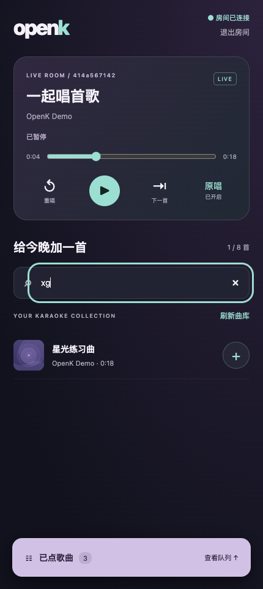
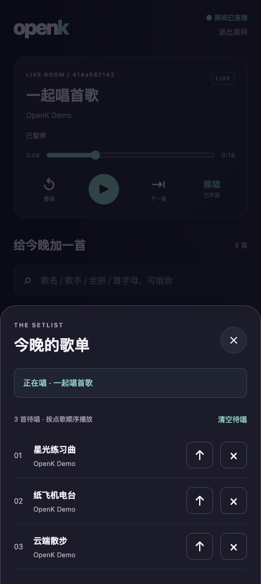

# 电视舞台与手机点歌

OpenK 保留经典单机点歌台，并增加共享房间。新界面不改变媒体存储位置：
歌曲、伴奏、歌词和录音仍在服务端；电视流式播放，手机只负责控制。
经典入口的搜索、混音和录唱步骤见[使用说明书](user-guide.md)。

| 入口 | 用途 |
| --- | --- |
| `/` | 配对部署为经典点歌台；账号模式自动进入当前房间 |
| `/library` | 曲库浏览与维护；账号模式的演唱使用当前房间 |
| `/rooms` | 聚会大厅，汇总展示中的房间，创建、加入与切换聚会 |
| `/tv` | 电视舞台、双轨播放、当前与下一句歌词 |
| `/remote` | 手机当前房间、搜索、共享队列、暂停、切歌与原唱切换 |
| `/admin` | 打开经典界面的管理抽屉，导入与维护曲库 |

<p></p>
<p></p>

截图使用虚构曲目、原创示例歌词和合成音轨。组合搜索与待唱队列：

<p>
</p>

## Responsive layout

The header account menu contains profile, sign-in and sign-out actions; long
nicknames no longer push navigation outside the screen. On phones, playback stays
compact: tap the song heading or `播放控制` to expand restart, next, guide and
singing controls. Play/pause and the bottom queue button remain directly available.
Members and room settings have separate expandable panels.

Wide screens place the player beside the song catalog. The lobby separates room
entry from the room directory; creating and joining use mutually exclusive forms.
TV setup keeps pairing and sound activation together, with room management beside
them on larger screens. The stage reserves separate areas for lyrics and controls.
The account-mode home/library exposes the shared room queue and full local player,
including lyrics, mixing and recording. A separate TV is optional. The phone
remote opens that full player when no receiver is online; it does not claim that
a playback flag alone means sound is being produced. On the TV, the ordinary play
button can also enable this device's audio through the same explicit gesture.

Room device rows show `播放器`, `遥控器` and `麦克风` separately from account
membership. The phone keeps these inside the expandable member/device panel so
song selection stays on the first screen; TV places them beside room settings,
not ahead of sound activation. See [device presence and roles](devices.md#connected-room-devices-and-roles).

## 开始演唱

启用[账号集成](accounts.md)的部署中，先登录自己的账号，即可自动恢复房间或进入
私人单人房。昵称在个人资料中修改；同一账号登录手机和电视，会进入同一个房间并只计为
一个成员。一个人也可以从当前房间进入 `/tv`，在本机启用声音，不必另找一台电视。
每位合唱者应使用自己的账号。大厅只是选择其他房间的视图，不会让用户退出当前房间。

未启用账号集成的可信网络部署继续使用原来的设备配对流程：

1. 电视和手机连接能访问 OpenK 的网络，电视打开 `/tv`。
2. 手机扫描电视上的二维码，或打开 `/remote` 填写房间号和六位配对码。
3. 手机上选择歌曲；电视上按一次「启用电视声音」，满足浏览器的用户手势要求。
4. 之后手机可继续点歌、调整队列和控制播放。声音只从电视输出。

You may enable the receiver before selecting a song. The first queued song then
starts automatically, and subsequent songs follow on completion. Appending a
song never overrides an explicit pause of the current song. Reloading, switching
rooms or losing the receiver still requires a fresh activation gesture.

二维码在本地生成，不会向第三方发送服务器地址或配对信息。手机配对凭据
保存在该浏览器本地；刷新后可恢复。经典点歌台原有的 localStorage 队列
不会自动导入房间，以免升级后突然播放此前的歌曲。

房间队列由服务端保存，命令带唯一编号避免网络重试导致重复点歌。
一个房间同时只有一个获得有效租约的电视播放器；歌曲结束也必须由这个
播放器确认，过期页面不能擅自切掉另一台电视正在唱的歌。

## 聚会大厅与多人演唱

账号模式下，加入房间前会先校验配对码，失败不会退出原房间；成功后账号及其设备跟随
新的当前房间。退出组队自动回到私人单人房，房主离开时将房主权限交给留下的成员；
结束聚会时，每个成员分别返回自己的单人房。个人资料、登录和退出入口在各客户端保持
一致，不能通过本机缓存或另填昵称冒充另一位用户。房主可重新生成邀请配对码。

下述按设备保存昵称和配对凭据的规则，仅适用于未启用账号集成的部署：

在 `/rooms` 创建具名房间，或选择大厅中的房间后输入六位配对码。房间列表只包含
名称、在线设备数、当前曲目等摘要，不公开配对码、控制凭据或完整歌单。
房主可在「房间与电视设置」中修改名称、控制是否在大厅展示、结束聚会。
旧房间升级后默认保持隐藏；新界面的建房选项可自行取消展示。

成员使用演唱昵称；昵称不是经过验证的网站账号身份，成员按配对设备计数。
在线状态随轮询更新，停止连接约 30 秒后显示离线。每首歌保存点歌人及演唱名单，
多位成员可以对同一首当前或待唱歌曲点「我要唱 / 一起唱」，也可自行退出。
这些信息不会采集麦克风，也不提供跨设备实时人声合唱或跨房间同步音频。

手机建房后，启用「允许电视用配对码加入」。另一台电视打开 `/tv`，
展开「加入另一个房间」并填写房间号与配对码，或从大厅点「电视加入」。
屏幕配对只获得房间读取和播放操作权限，不会获得房主凭据，也不能点歌、
修改歌单或管理房间。房间有播放租约时，其他电视不能抢占。
关闭允许电视加入的设置会撤销已经配对的屏幕及其播放租约。

本机按房间和角色保存独立凭据；旧版单房间缓存会被迁入，不把凭据放入链接。
打开大厅仅切换视图，保留配对；显式「退出房间」撤销手机或屏幕配对并移除其
演唱安排，但保留已经点入的歌曲。房主离开保留房间所有权，可从本机记录返回。
显式「结束房间」需要确认，会撤销所有设备并删除该房间状态，不删除曲库。

电视切换房间时先停止本机音轨、释放自己的播放租约并清除旧歌词，然后重新配对；
新房间仍需用户手势启用声音。网络异常时本机也会停止，旧租约最多约 12 秒后失效。
房间在空闲约 12 小时或创建满 48 小时后过期。当前最多 64 个房间，每房间
32 个手机配对及 8 个屏幕配对，但同时只允许一个实际播放器。

站点账号与房间配对是两个边界：认证代理保护的部署仍需登录后才能访问大厅，
不能把房间码当作绕过站点登录的访客凭据。房间队列不与经典本机队列自动混合。

## Fire TV

可在支持 Silk 浏览器的型号上尝试网页入口；不同 Fire TV 型号与浏览器版本的
媒体、全屏、方向键行为存在差异，不能把桌面 Chrome 结果当作 Fire TV 实机结果。

舞台采用大字号、低信息密度、边缘安全区和明确焦点。用方向键移动、
确认键操作；返回键用于关闭浮层或显示控制。全屏能力不可用时，仍可在
浏览器页面内演唱。

电视模式不申请麦克风权限，也不依赖遥控器麦克风。现场演唱建议使用
外置卡拉 OK 麦克风、混音器和音箱；需要浏览器录唱时使用经典入口和
确实支持音频输入的设备。不要通过手机到电视的普通网络音频传输实现实时监听。

浏览器首次播放、休眠唤醒或重新载入后可能要求再次点击启用声音；
页面会提示操作，不把播放被拒绝伪装成已经播放。若两轨缓冲状态不同，
应先等待资源就绪，再恢复同步。

## 部署与边界

- 两端使用同一个可访问的服务地址；不要在电视上使用手机访问不到的 `localhost`。
- 推荐 HTTPS。经典入口的麦克风需要安全上下文；自签证书需在实际设备上信任。
- 房间配对只保护房间控制，**不是整个管理后台的登录鉴权**。继续将部署限制在
  可信局域网，或在反向代理前使用已有的身份认证，不要直接裸露到公网。
- 房间状态文件位于 `OPENK_DATA_DIR`；该目录必须持久化并保持可写。
- 当前任务与房间状态使用单服务进程管理；不要让多个 Uvicorn 进程或服务副本同时
  写同一数据目录。扩展算力应增加 worker，而不是复制 Web 进程。
- 服务端与 worker 的领取协议增加了每次执行的凭据与隔离输出，升级时应一起更新，
  不要让旧 worker 向新版服务端交付结果。等待任务空闲后升级最稳妥。
- Mac worker 只保留模型缓存与自动清理的短期工作文件，不建立永久音乐副本。
- `/media` 仅提供音视频、歌词文本／JSON 和常见栅格图片；不提供 SVG、HTML 等可执行文档。
  这项防护不能代替访问认证，详细边界见 [安全说明](../SECURITY.md)。

歌词重对齐现在立即返回操作 ID，`GET /api/operations/{id}` 可查询状态。
刷新后前端可继续跟踪；后台处理不会切换正在播放的歌曲。原歌词保留到
新版本完整生成后才切换，失败时继续使用旧版本。

## 回归测试

```bash
python -m pip install -r requirements-test.txt
npm install --ignore-scripts
python scripts/run_tests.py
```

运行 `tests/python/`、`tests/frontend/` 和 `tests/browser/` 下的全部套件。
可用 `--group python|frontend|browser` 或测试文件名选择范围；未知名称会报错。
测试任务目录与真实曲库隔离；
浏览器用标准库生成的合成音轨，不下载音乐、不执行模型推理。

真实浏览器回归使用已安装 Chrome 的 DevTools 协议，无额外自动化框架。
默认查找常见 Chrome 安装位置，也可设置：

```bash
OPENK_TEST_CHROME=/path/to/chrome \
OPENK_TEST_ARTIFACTS=/tmp/openk-browser-artifacts \
python scripts/run_tests.py
```

浏览器回归涵盖 TV 建房、手机配对点歌、双轨播放、暂停、原唱切换、
自动接歌、手机刷新与断线重连，以及遥控器焦点、手机和平板布局。
聚会回归还覆盖独立手机加入合唱、手机建房后邀请另一台电视、跨房间隔离、
切换后的旧请求与歌词隔离、结束房间后的本机静音，以及大厅的窄屏触摸操作。
经典点歌台覆盖 320–1440px 的列表布局、窄屏封面视图与核心控件触摸尺寸。
录唱回归通过原生合成 `MediaStream` 驱动真实 Web Audio 混音和 `MediaRecorder`，
覆盖切歌后的录音归属与上传，不打开机器的真实麦克风。麦克风授权拒绝与超时由
状态回归覆盖；物理设备的权限、驱动和输入延迟仍需实机确认。

`browser/test_account_playback.js` additionally covers the actual one-device
account-home flow: picking starts local audio without a TV, the full lyrics and
recording controls remain usable, remote controls operate that same receiver,
and room changes stop audio/microphone access. Image release checks may point
`--source-root` at an extracted runtime; the synthetic catalog and processes are
still isolated and cleaned up.

测试结束关闭专用服务与浏览器并清理合成媒体；指定截图目录则保留截图。
缺少 Chrome 或依赖会明确失败，不把跳过算作完整通过。

重拍文档使用的虚构展示场景：

```bash
OPENK_TEST_ARTIFACTS="$PWD/.test-artifacts/screenshots/images" \
.venv/bin/python scripts/run_tests.py --group browser
```

对应实现位于 `tests/browser/test_browser.js`；演示素材由 `tools/demo.py` 统一生成。
公开图片清单和复制步骤见[截图生成说明](screenshots/README.md)，不要提交失败诊断图或配对码。

Fire TV 实机还应覆盖：从电视实际地址加载、声音解锁、两轨缓冲与切换、
连续播放、遥控器返回行为、休眠唤醒和外部音响延迟。自动化不替代这些设备差异。
