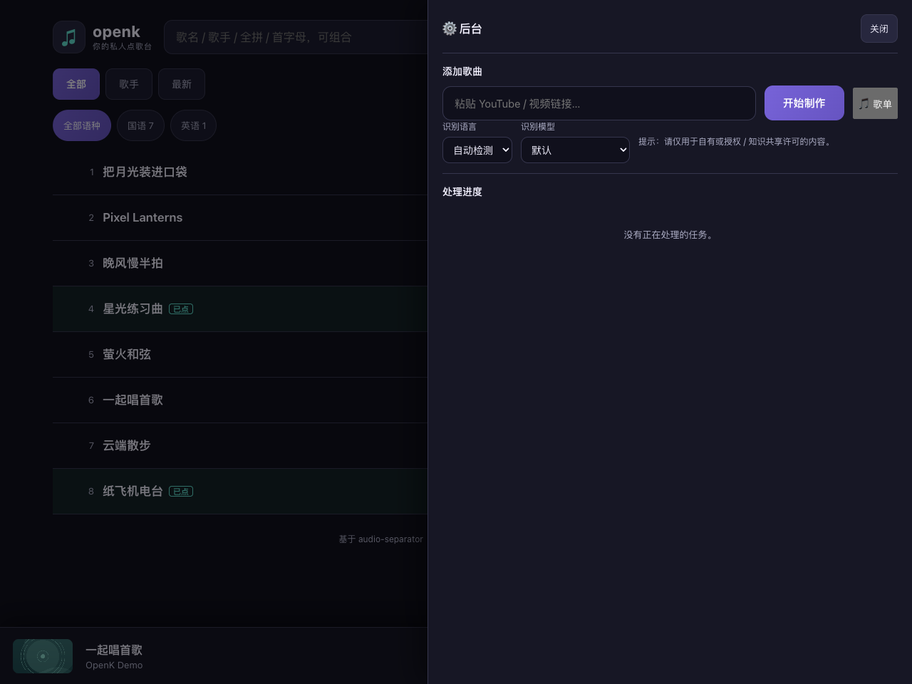
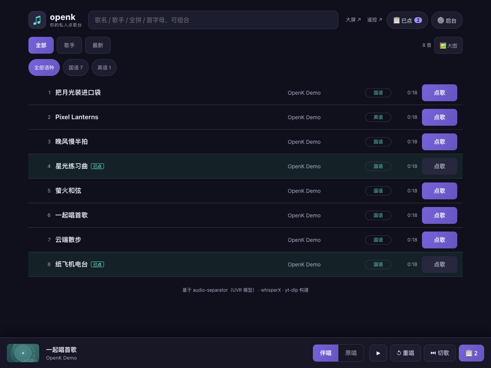
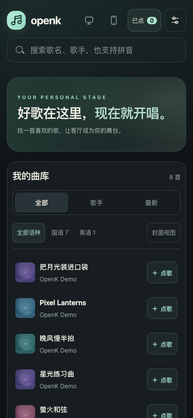
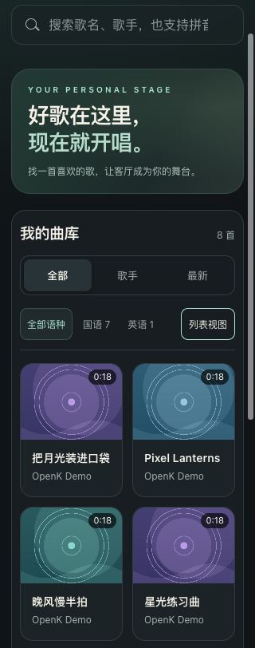
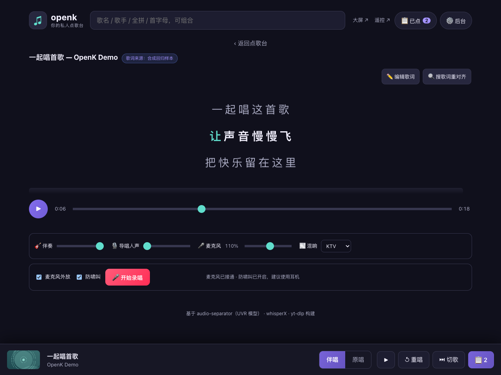
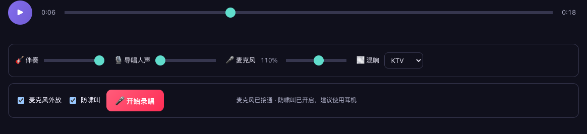

# OpenK 使用说明书

本说明对应 `main` 分支；稳定镜像请同时参考其版本标签下的文档。
首次安装见 [README](../README.md#用-docker-运行跨平台最省事)，
NAS 与算力机配置见[分布式部署](distributed.md)。

## 选一个入口

**Account mode:** signing in resumes the current room or creates a private solo
room. The home page keeps the full player: pick a song to sing on this device,
or use `在本机播放` when returning to an existing song. Lyrics editing, guide,
mixing and recording are not removed by account integration. Another active
receiver keeps its exclusive playback lease; room controls operate that receiver
instead of creating competing sound.

`/rooms` selects rooms without leaving the current one first; `/tv` is an optional
big-screen layout and `/remote` is a controller. `/library` retains catalog
maintenance and the same room-bound player. The profile nickname and current room
follow the account across devices. See [accounts and rooms](accounts.md) for
membership, invitations and sign-in details.

The playback, lyrics, mixing and recording instructions below apply to the full
player in either mode. Only the browser-local queue applies exclusively to
standalone deployments; account mode always uses the server's shared room queue.

| 想做什么 | 打开哪里 | 声音与队列在哪里 |
| --- | --- | --- |
| 在电脑 / 平板上点歌、看歌词、录唱 | `/` | Account mode: shared room queue; standalone: browser-local queue |
| 聚会建房、加入或切换不同房间 | `/rooms` 或顶部「房间」 | 每房间独立歌单，成员共享点歌与演唱安排 |
| 电视唱、手机点 | 电视 `/tv`，手机 `/remote` | 电视播放，房间队列由服务端保存 |
| 添加歌曲、查看制作进度 | 右上角「后台」或 `/admin` | 管理同一个服务端曲库 |

Opening `/` on a phone gives the full player, not a silent TV remote. Use `/remote`
when only controlling another receiver. Standalone local queues and device-paired
room queues remain separate; account-mode pages all use the current room.

## 第一次添加歌曲

1. 打开「后台」，粘贴有权使用的视频链接，选择识别语言后点「开始制作」。
2. 歌单链接使用「歌单」先预览，再勾选歌曲并点「导入选中」。
3. 服务端启用了本地媒体导入时会显示「本地文件」。这里只浏览服务端允许的目录，
   不是上传手机里的文件；选择条目后确认导入。
4. 观察下载、分离、歌词处理进度。完成的歌曲进入曲库，失败任务可检查错误并重试。

首次运行模型通常较慢；远程 worker 离线时，相关任务会排队等待。
查看后台进度不会切掉当前演唱的歌曲，不必为了等待制作而反复重新提交。

Failed tasks show `重试` and `删除`; cancelled tasks can also be deleted. Deletion
requires confirmation and removes only that job and its working files, not the
original imported media outside the job directory. The list and task badge refresh
automatically without changing the queue, current audio or microphone session.
If another device has retried or completed the job, the failed-only deletion is
rejected and the latest state is shown instead.

## 找歌和排队

搜索支持歌名、歌手、全拼、首字母以及空格组合，例如 `周杰伦 稻香`、`zjl dx`。
繁简、大小写、全半角可互通；不会自动猜测错别字或歌手别名。
在经典页面按 `/` 可聚焦搜索，输入中文组词时会等文字确认后再更新结果。

用「拼音 / 歌手 / 常唱 / 最新」切换浏览方式，再用语种按钮缩小范围。
展开「首字母」可按 A–Z 筛选，数字和其他文字归入 `#`；歌手页按歌手首字母，
进入歌手后按歌名首字母。「返回歌手列表」会保留原来的字母和页码。
歌曲、封面和歌手列表每页最多 24 项，用「上一页 / 下一页」翻页，不再一次展开整个曲库。
搜索仍查全部匹配歌曲，不受当前页码、首字母、歌手或常唱榜限制，但保留语种筛选；
结果过少时先检查语种是否选对。清空搜索会回到之前的分类。
「封面视图 / 列表视图」只改变展示，不改变曲库或队列。

「常唱」只在账号模式下显示，按**我的最近 500 条有效播放记录**统计，
次数多的在前，同次数优先最近播放；每首会显示播放次数，不代表全网热度。
播放设备真正播放一小段才累计，只点歌、拖动进度或重复发送进度不会刷高次数。
清除或删除播放历史后，对应次数也会移除；没有记录时不会伪造排行。
需要立即更新时点「刷新常唱」。手机遥控页也支持拼音索引、分页和「我的常唱」，
其统计可用顶部「刷新」更新。浏览、筛选和翻页不会切歌或改变已点队列。

在经典点歌台，点歌曲或「点歌」会加入已点队列；空闲时会尝试开始播放。
浏览器阻止自动播放时，请按播放按钮明确启用声音。
打开「已点」可调整顺序、移除歌曲或清空队列；这是修改待唱列表，不是删除曲库文件。

房间里还没有歌时，也可以先在播放设备上点「启用播放器」等待。
手机点入第一首歌后会自动开唱，唱完自动接下一首；追加歌曲不会取消当前歌曲的手动暂停。
首次开声、刷新页面或切换房间后，仍需要在播放设备上点一次，不会绕过浏览器授权。

主页面的房间设备列表会显示每台设备的「播放器／遥控器／麦克风」角色和实际播放状态。
手机上展开成员与设备列表，电视上打开房间面板即可查看。同一账号的电脑和手机分别显示，
同一浏览器的多个标签页则合并显示。麦克风角色只表示本机用途，不会把人声传送到电视。

## 播放、歌词与混音

悬浮播放条可暂停、重唱、切到下一首、切换原唱 / 伴唱和打开队列。
点击播放条歌名展开歌词页；返回点歌台不会停止歌曲，可边唱边点。
点击「切歌」会从头播放下一首，即使上一首处于暂停状态；没有下一首时停止。

| 控件 | 作用 |
| --- | --- |
| 伴唱 / 原唱 | 默认只放伴奏；原唱模式混入已分离的人声音轨 |
| 进度条 / 歌词行 | 拖动进度或点击歌词，跳到对应位置 |
| 伴奏 / 导唱人声 | 分别调整两条音轨的音量 |
| 麦克风 / 混响 | 调整监听与录唱效果；需要先授权麦克风 |
| 编辑歌词与时间 | 修改文字、每行起止时间和整体偏移；保存后同步更新 |
| 搜歌词重对齐 | 从 LRCLIB 选正确歌词，后台重做对齐，不重新下载或分离 |

重对齐完成前继续使用原歌词；完成后切换新结果，失败不会把原歌词清空。
有「无词」标记的歌曲仍能播放伴奏，但没有可用字幕。
### 手动补前奏或调整歌词时间

进入「编辑歌词与时间」后，可边播放边修改。时间支持秒数或分:秒，最多三位小数，
例如 `12.5` 与 `00:12.500` 都表示 12.5 秒；开始和结束均可直接输入。

1. **整首漏算前奏**：播放到任意一句真正开口的位置，点该行的「对齐整首」。
   这会把整首歌词一起平移，保留行间距和逐字节奏，也可在暂停定位后操作。
2. **已知偏移量**：填写「整体偏移（秒）」再应用。正数延后、负数提前，
   例如 `+12` 用于补 12 秒前奏；「-0.1 秒 / +0.1 秒」可继续微调。
3. **只有某一句不准**：手动填写该行起止时间，或点「本行对齐」，
   把该行起点移到当前播放位置并保持其时长，其他行不变。
4. 点「试听本句」从这句前一秒试听。满意后点「保存」；「还原时间」
   只恢复打开编辑器时的时间、保留文字改动，「取消」则放弃全部草稿。

这些调整不需要重跑语音识别。移动或拉伸一行会同步调整其逐字时间；
改了文字的行会重新分配逐字时间。负时间、倒序和超出歌曲时长会明确提示，
不会把部分调整偷偷保存。

当前时间标记以**实际播放设备**为准；本页不是播放器时仍可输入时间和整体偏移，
但不会拿本机停在零秒的音轨冒充电视的播放位置。
如果其他设备已发布新版歌词，保存会保留你的草稿并提示冲突，取消后可载入新版再改。
歌词文字或版本本身选错时，仍建议先搜索正确歌词，再进行手动微调。

## 麦克风与录音

局域网设备通常需要 **HTTPS 和浏览器麦克风授权**；`localhost` 可使用 HTTP。
电视入口不申请麦克风权限，Fire TV 遥控器麦克风也不是浏览器录唱输入设备。

1. 在经典歌词页点击「开始录唱」，允许浏览器使用所选麦克风。
2. 建议先用耳机、小音量试听，再调整麦克风音量和混响。
3. 完成后停止录唱，等待上传；可在该歌曲的「我的录音」中回放、下载或删除录音。

录音绑定开始录唱时的歌曲，切歌不会把它挂到下一首。
上传失败会进入「录音保存中心」，可重试或下载备份；
**未保存的音频仍在当前页面内存里，不要关闭或刷新页面。**

「麦克风外放」默认勾选，但授权和音频引擎就绪后才生效。
切到后台会暂停监听，回到页面需明确恢复；这不会主动停止正在进行的录音。
防啸叫只辅助控制监听反馈，不能替代合理的音量、麦克风摆放或实机调试。

In account mode, an actual operating-system audio suspension is different from
merely hiding the tab: the player stops playback and microphone capture and
releases the room's playback lease. Captured audio is retained for saving. Use
`在本机播放` to resume explicitly; another device's active lease is never stolen.

## 电视和手机一起唱

1. 电视打开 `/tv`；手机扫描二维码，或在 `/remote` 输入房间号与配对码。
2. 手机点歌后，电视上按「启用电视声音」。
3. 后续在手机上搜索、排队、暂停、重唱、切歌和切换原唱，声音仍从电视输出。

二维码在本地生成。房间凭据保存在浏览器里，刷新后可恢复配对，
但电视重载或唤醒后可能需要再次启用声音。
Fire TV 浏览器、遥控器及外部音响的限制见[电视指南](tv.md)。

## 多人聚会与房间切换

账号模式使用个人资料里的昵称和服务端当前房间，不使用以下按浏览器保存身份的规则。
查看大厅时仍留在当前房间；配对失败不离开原房间，成功后同一账号的设备跟随新房间。

打开 `/rooms`，可以查看大厅中展示的房间，也可以创建一间有名字的聚会房间。
输入演唱昵称后，用配对码加入；已在本机配对过的房间可直接返回。
公网部署仍需先完成站点登录，房间码不能绕过网站账号保护。

每首歌会显示点歌人。点「我要唱」或「一起唱」即可加入同一首歌的演唱名单，
也可以退出合唱；这只是演唱安排，不会采集或传送手机麦克风声音。

手机创建房间时可勾选允许电视加入。电视打开 `/tv` 的「加入另一个房间」，
输入房间号和配对码，再按一次启用声音。电视只获得播放权限，不能管理房间。
不同房间的歌单与播放互不影响，同一房间仍只有一台电视可以播放。

「房间大厅」保留本机配对，便于来回切换；「退出房间」撤销当前手机的配对，
但不删除共享歌单。房主离开仍保留所有权，只有房主的「结束房间」会清空该房间
并让所有设备退出。结束房间不会删除曲库歌曲。

## 常见问题

| 现象 | 先检查 |
| --- | --- |
| 找不到刚添加的歌 | 是否仍在处理、是否失败，以及当前搜索 / 语种筛选 |
| 点击后没有声音 | 浏览器播放授权、设备输出、伴奏音量；电视模式是否已启用电视声音 |
| 有伴奏但没有逐字歌词 | 是否标为无词、是否只有逐行歌词、对齐模型是否可用 |
| 无法使用麦克风 | HTTPS / localhost、站点权限、系统输入设备以及设备是否被占用 |
| 回到页面后听不到自己的声音 | 监听可能因页面隐藏暂停，使用「恢复麦克风外放」 |
| 录音没有保存 | 查看保存中心；先下载未保存音频，再排查网络和磁盘空间 |
| 两台设备的已点列表不同 | Account mode: check the account/current room; standalone: local and paired-room queues are separate |
| 命令行改了元数据，网页没变化 | 离线工具写盘后需重启 API 加载；仅刷新网页不会重新读 `status.json` |
| 页面仍是旧样式 | 先保存待上传录音，再刷新；确认运行的是目标版本，而非仍在旧稳定版 |

## 数据与维护边界

歌曲、分离结果、歌词和已上传录音保存在服务端持久目录；
浏览器会流式播放和缓存媒体，不是曲库的主存储。
NAS + worker 部署中，算力机只保留模型缓存和可清理的临时推理文件。

离线批量修改前备份数据、停止 API 和 worker；不要在演唱中直接改 `status.json`。
在线除重通过 API 删除淘汰任务，会连同这些任务的音轨、歌词和录音一起删除，
源文件移入 `_重复/` 也不等于完整备份。命令和预览 / 写入规则见
[程序与脚本索引](project-layout.md)。

当前没有全站账号登录；配对码不是后台的登录保护。
请仅用于可信网络，或放在认证反向代理后。见[安全说明](../SECURITY.md)。

本文截图均为虚构曲目、原创示例歌词与合成音轨；
[截图生成说明](screenshots/README.md)记录了可复现的素材来源。
